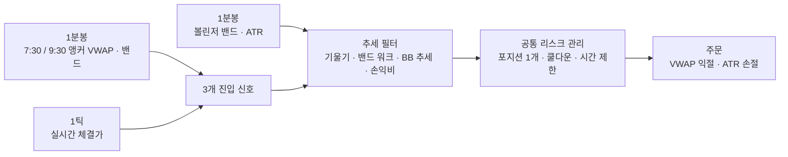

# NQ VWAP 밴드 스캘핑 전략

**QVSD 2기 퀀트 트레이딩 대회 【서브 2위】** · 2026.09 ~ 2026.10

나스닥100 선물(NQ)을 대상으로, 장 초반 VWAP 밴드에서 되돌림을 노리는 단기 자동매매 전략입니다. 성격이 다른 3개의 진입 로직과 여러 겹의 추세 필터를 하나의 시스템으로 묶었고, NinjaTrader 8(C#, NinjaScript)으로 구현했습니다.

## 설계 아이디어

장 초반 NQ는 VWAP을 중심으로 표준편차 밴드 사이를 오가는 경우가 많습니다. 그래서 **밴드 밖으로 나갔다가 다시 들어오는 순간 VWAP을 목표로 되돌림 매매**하는 것을 기본으로 삼았습니다.

다만 강한 추세장에서는 가격이 밴드를 따라 계속 밀려 올라가거나 내려가서(밴드 워크) 역방향 매매가 연속 손실로 이어집니다. 이를 막기 위해 **VWAP 기울기, 밴드 이탈 지속 여부, 볼린저 밴드와 VWAP의 위치 관계**로 추세 강도를 판단해 역추세 진입을 걸러내고, 반대로 추세가 지나치게 과열된 구간에서만 제한적으로 역방향 진입을 허용했습니다.



## 데이터 구조 (멀티 타임프레임)

| 시간 단위 | 역할 |
| --- | --- |
| 1분봉 (주 차트) | VWAP·표준편차 밴드, 볼린저 밴드(14, 2), ATR(10) 계산. 필터는 모두 직전 마감 봉 기준 |
| 5분봉 | EMA(20) 추세 방향 (선택 필터) |
| 1틱 | 봉 마감을 기다리지 않고, 가격이 밴드 안으로 돌아오는 순간 시장가 진입 |

VWAP은 프리장 7:30 ET부터 코드에서 직접 누적 계산하고, 9:31 ET 이후에는 9:30 앵커 VWAP(NinjaTrader 내장 OrderFlowVWAP)으로 전환합니다. 밴드 폭은 프리장 0.8σ, 정규장 1.2σ입니다.

## 3개 전략

| 전략 | 유형 | 진입 조건 요약 |
| --- | --- | --- |
| **① 밴드 터치 되돌림** | 평균회귀 | 이번 1분봉에서 밴드 밖을 찍었다가 다시 밴드 안으로 들어오는 첫 틱에 시장가 진입. 익절 = VWAP |
| **② 밴드 이탈 후 재진입** | 평균회귀 | 종가가 밴드 밖에서 크게 마감한 뒤, 나중에 가격이 다시 밴드에 닿는 틱에 진입. 익절 = VWAP |
| **③ 9:30 시가 통과** | 추세 추종 | 9:30 시가를 기준가로 잡고, 9:31~9:40 사이 가격이 시가를 통과하는 방향으로 진입. 10pt 익절 / 10pt 손절, 9:40 강제 청산 |

추가로, 볼린저 밴드 하단이 VWAP 상단 밴드보다 위에 있을 만큼 **상승이 과열**되면 상단 밴드 터치에서 숏(하락 과열이면 반대로 롱)으로 바로 진입하는 과열 진입 로직이 있습니다. 과열 구간 하나당 방향별 1회만 진입합니다.

## 추세 필터

| 필터 | 내용 |
| --- | --- |
| VWAP 기울기 | 최근 10개 봉 동안 VWAP이 봉당 1틱 넘게 오르면 숏 금지, 내리면 롱 금지 |
| 밴드 워크 | 종가가 밴드 밖에서 마감하면 그 방향으로의 역추세 진입 금지 |
| BB 추세 | BB 하단 > VWAP이면 강한 상승추세로 보고 숏 금지, BB 상단 < VWAP이면 롱 금지 |
| 손익비 | 진입가에서 VWAP까지 거리가 손절폭의 1배 미만이면 진입하지 않음 |
| 완익 후 스위칭 | 익절로 끝난 직후 2분간 모든 진입 금지. 이후 반대 방향 진입은 가격이 볼린저 밴드에 새로 닿은 뒤에만 허용 |

## 리스크 관리

**주문 단위**

- NQ 1계약, 익절은 VWAP. 보유 중에는 1분봉 마감마다 익절가를 최신 VWAP으로 갱신합니다 (진입가보다 유리할 때만).
- 손절폭은 ATR(10) × 1.0에 연동하되 전략 ①은 10~25pt, 전략 ②는 20~30pt 범위로 제한합니다. 롱은 고정 손절, 숏은 ATR 손절이 기본값입니다.
- 2레그 옵션(UseLegB)을 켜면 B 레그가 반대편 밴드를 목표로 하고, A 레그 익절 후 B 레그 손절을 본전으로 옮깁니다.

**포트폴리오 단위**

- 한 번에 하나의 포지션만 보유하고, 롱과 숏 주문이 동시에 살아 있지 않도록 모든 진입을 하나의 관문(`CanEnter`)에서 검사합니다.
- 롱 청산 직후 숏(또는 그 반대) 주문은 2초 뒤에 내서 주문 충돌을 막습니다 (실시간 전용).
- VWAP 전략은 08:30~09:30, 09:45~10:30 ET에만 진입하고, 9:30 개장 시 남은 VWAP 포지션을 정리합니다.
- 10:30 ET에 모든 포지션을 청산합니다.

## 실행 방법

1. NinjaTrader 8에서 `New → NinjaScript Editor`를 엽니다.
2. `Strategies` 폴더에 `MyCustomStrategy4.cs`를 추가하고 컴파일(F5)합니다.
3. Strategy Analyzer에서 NQ 1분봉 차트를 선택하고 `VwapBandAdjScalper4`로 백테스트합니다.

9:30 앵커 VWAP에 내장 `OrderFlowVWAP`을 사용하므로 Order Flow+ 기능이 필요합니다. 주요 파라미터(전략별 on/off, 밴드 배수, 손절 범위, 필터 on/off 등)는 모두 전략 속성 창에서 조정할 수 있습니다.

## 파일 구성

```txt
├── README.md
└── MyCustomStrategy4.cs     # 전략 전체 코드 (약 1,750줄)
```

---

본 저장소는 대회 참가 결과를 기록한 포트폴리오이며, 투자 권유가 아닙니다.
